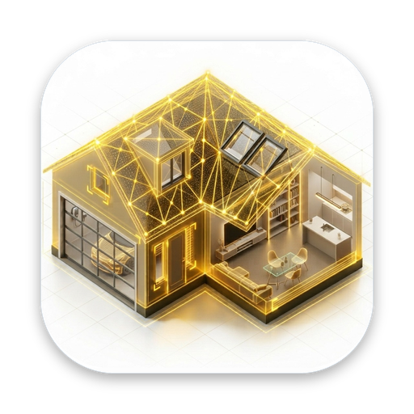

<p align="center">
  
</p>

<h1 align="center">dWalkScan (bau-scan)</h1>

<p align="center">
  <strong>Autonomous LiDAR 3D Scanner, Precision Architectural 2D Floor Plans & BIM Renovation Studio for iPhone & Mac</strong>
</p>

<p align="center">
  <a href="https://github.com/itsmeBablu/bau-scan/releases"></a>
  <a href="https://developer.apple.com/ios/"></a>
  <a href="https://developer.apple.com/macos/"></a>
  <a href="https://developer.apple.com/augmented-reality/roomplan/"></a>
  <a href="https://github.com/itsmeBablu/bau-scan"></a>
  <a href="LICENSE"></a>
</p>

---

**dWalkScan** transforms your LiDAR-equipped iPhone into a professional-grade building survey, CAD/BIM modeling, and renovation management workstation.

Capture single rooms, entire multi-story buildings, or complex mechanical plant rooms (**Technik**) in one continuous walkthrough. Instantly produce **architecturally dimensioned 2D floor plans (DIN standard)**, high-fidelity **3D meshes**, and detailed **BIM models**. Edit and reconfigure your spaces in the real-time **Studio 3D Editor**, compute **opening-aware material takeoffs**, and export directly to **Autodesk Revit**, **IFC**, **CAD (DXF / SVG)**, and **client PDF deliverable packages**.

The universal companion **Mac application** shares the exact same Swift core codebase, enabling seamless multi-device collaboration through **iCloud Drive** or local offline storage.

---

## 🌟 Highlights & Key Capabilities

```
┌────────────────────────────────────────────────────────────────────────────────────────────────────────┐
│                                         dWalkScan Architecture                                         │
├───────────────────────────────┬───────────────────────────────┬────────────────────────────────────────┤
│     1. LiDAR Field Capture    │       2. Studio 3D Editor     │          3. Deliverables & BIM         │
│  • Single Rooms & Multi-Story │  • Real-time 3D Spatial Layout│  • Autodesk Revit (.rvt / IFC) Export  │
│  • Technik MEP Plant Rooms    │  • Office & Home Collections  │  • Multi-Level Separated DXF / SVG     │
│  • Continuous Walkthrough     │  • Automatic 32" Monitor Rule │  • Client PDF Reports & Photo Gallery  │
│  • Spatial 3D Survey Photos   │  • Grid Snap & Cutaway Walls  │  • Net Wall & Floor Material Takeoffs  │
└───────────────────────────────┴───────────────────────────────┴────────────────────────────────────────┘
```

---

### 🏢 1. Continuous Multi-Story & Room Capture
* **Continuous House Walkthrough:** Walk room-to-room and up/down stairs without interruption. Apple RoomPlan captures connected spaces into a unified coordinate system.
* **Automatic Multi-Story Clustering:** The built-in `StoryDetector` analyzes vertical floor datums and wall footings, automatically segmenting multi-level buildings into distinct floors (`Ground floor`, `Upper floor 1`, etc.).
* **Radiator & Opening Recognition:** Detects radiators, windows, and doors with measured physical dimensions and parapet heights (`BRH`).

### 🔧 2. Technik MEP & Industrial Plant Rooms
* **Dedicated MEP Scanning:** Specialized scanning mode designed for boiler rooms, heating systems, and mechanical infrastructure.
* **Component Classification:** Automatically identifies boilers, buffer storage tanks, circulation pumps, heating manifolds, electrical panels, round ducts, rectangular ventilation ducts, and piping networks.
* **1-Tap Equipment Layout Generator:** Automatically generates standard equipment arrangements for empty plant rooms to jumpstart facility planning.
* **Multimodal Google AI / Gemini Integration:** Connect your Gemini API key to analyze survey photos and enrich equipment registers with technical specifications and German trade references.

### 📸 3. House Survey Photo Mode & 3D Spatial Poses
* **In-Scan High-Res Photos:** Capture detail photographs of architectural features, electrical panels, or equipment nameplates without leaving the scanner.
* **3D Directional Markers:** Each photo is geolocated with its exact 3D camera position ($X, Y, Z$) and viewing angle ($\text{yaw}$), rendered as interactive spatial pins on both 2D floor plans and 3D Studio scenes.
* **Photo Gallery & Notes:** Review captured site photos alongside their floor plan context.

### 🛋️ 4. Studio 3D Editor & Furniture Collections
* **Interactive 3D Manipulation:** Position, rotate, elevate, and replace models with $5\text{ cm}$ grid snapping, wall alignment, and real-time collision/overlap checks.
* **Cutaway & Plan Views:** Toggle cutaway front walls to look directly into complex spaces, inspect 3D dimensions, or switch to an orthographic 2D floor plan.
* **Dedicated Office Furniture Collection:**
  * **Desks:** Ergonomic C-frame desks with modesty panels and under-desk drawer pedestals.
  * **Office Chairs:** 5-star wheeled base task chairs with pneumatic lift columns and lumbar backrests.
  * **Conference Tables:** Boardroom tables with dual pedestal supports and recessed cable management troughs.
  * **Computer Workstations:** Desktop PC towers with status indicators and stabilizing feet.
  * **Monitors (32″ Standard):** Widescreen desktop displays ($0.72 \times 0.52 \times 0.20\text{ m}$) on angled stands with 16:9 proportions.
  * **Bookshelves & Whiteboards:** Archival bookcases with books and mobile magnetic presentation boards.
* **Automatic 32″ Screen Detection:** Displays captured by LiDAR with diagonal $\le 32''$ (or width $\le 0.78\text{ m}$) are **automatically classified as Monitors**, while larger screens are categorized as **Televisions**.
* **Residential Furniture Library:** Sofas, double beds, lounge chairs, dining tables, storage cabinets, refrigerators, stoves, sinks, toilets, bathtubs, showers, and laundry washers.
* **Model Library Category Pills:** Filter seamlessly between **All**, **Office**, **Living**, and **Kitchen & Bath**.

### 🏗️ 5. Renovation Takeoffs & Project Tools
* **Opening-Aware Material Takeoffs:**
  * **Net vs. Gross Wall Area:** Automatically computes total wall area and subtracts door/window openings to determine true paintable surface area.
  * **Flooring & Ceiling Area:** Surface calculation with configurable waste allowance percentage sliders ($+5\%$, $+10\%$, $+15\%$).
  * **Perimeter:** Baseboard and skirting length minus doorway threshold widths.
* **Interactive Plan Task Pins:** Drop punch-list task pins onto 2D plans with statuses (`Open`, `In Progress`, `Resolved`) and link them to renovation phases (`Existing`, `Demolition`, `Proposed`).
* **Field Measurement Verification:** Log physical laser distance meter or tape measure checks against LiDAR-scanned dimensions to maintain rigorous survey records.

### 📐 6. Universal BIM, CAD & Deliverables Export
* **Autodesk Revit & IFC:** Export native IFC building models with mapped architectural walls, doors, windows, and MEP equipment classifications.
* **Multi-Level CAD Separation:** Automatically separates multi-story buildings into per-floor archives (`level-0.dxf`, `level-1.dxf`, `level-0.svg`, etc.) while embedding the true measured elevation datum.
* **Client PDF Deliverable Reports:** 1-click comprehensive report generator compiling project covers, scaled 2D plans, survey photos, room dimensions, equipment registers, and punch-list schedules.
* **Full Format Support:**
  * **2D:** Scaled PDF (A4 landscape), layered SVG (CAD layers), DXF R12, high-res PNG.
  * **3D:** USDZ (parametric & mesh), OBJ, STL, PLY.
  * **Data:** CSV material takeoff schedules, JSON project archives.

---

## 🎨 Design System & Liquid Glass

dWalkScan features a tactile, blur-backed **Liquid Glass** user interface tailored for iOS 18+ and macOS 15+:

* **Primary Yellow (`#facc15`):** Active selections, brand focus, dimension callouts, and key interactive controls.
* **Secondary Yellow (`#fef08a` / `#fef3c7`):** Badge surfaces, subtle highlights, and accent pills.
* **Dark Charcoal (`#111110` / `#272000`):** High-contrast typography and CAD-standard walls.
* **Architectural Dual Units:** Switch dynamically between millimeters (`mm`), meters (`m`), or dual formats with standard dot-decimal notation (`.`).
* **Localization:** Fully localized in **English** and **German (Deutsch)** with localized German MEP equipment catalogues.

---

## 📊 Feature Matrix

| Capability | Status | Technology / Details |
|---|---|---|
| **LiDAR Room Scanning** | ✅ Built | Apple `RoomCaptureView`, real-time coaching & surface tracking |
| **Multi-Story House Merge** | ✅ Built | Continuous walkthrough, `StoryDetector` elevation clustering |
| **Technik MEP Plant Room Scan** | ✅ Built | Boiler, tank, manifold, pump, panel, duct, and pipe detection |
| **Multimodal Gemini AI** | ✅ Built | Photo analysis & German MEP technical equipment specifications |
| **Spatial Survey Photos** | ✅ Built | In-scan photo capture with 3D camera pose markers and gallery |
| **Studio 3D Editor** | ✅ Built | Real-time 60 FPS SceneKit editor, $5\text{ cm}$ snap, front-wall cutaway |
| **Office Furniture Collection** | ✅ Built | Desks, office chairs, conference tables, PCs, monitors, whiteboards |
| **Automatic 32″ Screen Rule** | ✅ Built | Screens $\le 32''$ auto-classified as Monitor; $> 32''$ as Television |
| **Material Takeoffs & Quantities**| ✅ Built | Opening-aware net wall area, floor area, perimeter & waste sliders |
| **Plan Task Pins (Punch List)** | ✅ Built | Interactive 2D plan task pins linked to Demolition / Proposed phases |
| **Autodesk Revit & IFC Export** | ✅ Built | Native IFC generation for architectural and MEP models |
| **Multi-Level CAD Separation** | ✅ Built | Separate per-floor DXF / SVG / 3D files with scan elevations |
| **Client PDF Deliverables** | ✅ Built | Full project PDF package with plans, photos, and quantities |
| **Units: mm & meters** | ✅ Built | User-selectable `mm`, `m`, and `dual` with DIN-standard annotations |
| **Mac Desktop Companion App** | ✅ Built | SwiftUI macOS 15+ split view, drag-and-drop, native printing (⌘P) |
| **iCloud Drive Sync** | ✅ Built | Seamless sync across devices using conflict-safe packages |
| **Localization (EN / DE)** | ✅ Built | Full English and German language catalogue & in-app switcher |

---

## 📱 Hardware & OS Requirements

* **iOS:** iPhone **Pro** model with LiDAR (iPhone 12 Pro through 17 Pro) or iPad Pro with LiDAR, running **iOS 18.0+**.
* **macOS:** Mac with Apple Silicon or Intel running **macOS 15.0+**.
* **Development:** The quality-review CI uses the default Xcode toolchain on `macos-26` with `xcodegen` (`brew install xcodegen`). Older toolchain compatibility remains unverified; deployment remains iOS 18 / macOS 15.
* **Sync:** Apple Account signed in for iCloud Drive (local storage functions completely offline).

---

## 🛠️ Build & Installation

The Xcode project is generated deterministically using [XcodeGen](https://github.com/yonaskolb/XcodeGen):

```bash
# 1. Generate Xcode project
xcodegen generate

# 2. Build and run unit tests for iOS Simulator
xcodebuild -scheme RoomScanner \
  -destination 'platform=iOS Simulator,name=iPhone 16 Pro' \
  CODE_SIGNING_ALLOWED=NO test

# 3. Build and test macOS companion app
xcodebuild -scheme RoomScannerMac \
  -destination 'platform=macOS' test
```

---

## 🪟 Windows Sideloading (No Mac Required)

You can build and test **dWalkScan** on your physical iPhone directly from Windows using GitHub Actions and Sideloadly:

<details>
<summary><strong>Click to expand step-by-step Windows sideloading guide</strong></summary>

### 1. Build the Unsigned IPA on GitHub Actions
1. Navigate to the **Actions** tab on your GitHub repository.
2. Select the **Build unsigned iPhone IPA** workflow from the left sidebar.
3. Click **Run workflow**, select `main`, and confirm.
4. When finished, download the **`dWalkScan-local-unsigned-ipa.zip`** artifact.
5. Extract the ZIP on Windows to obtain `dWalkScan-local-unsigned.ipa`.

### 2. Install Sideloadly & Prerequisites
1. Install standalone **iTunes** and **iCloud** for Windows (use official desktop installers, not the Microsoft Store version).
2. Install [Sideloadly](https://sideloadly.io/).

### 3. Sign & Install onto iPhone
1. Connect your unlocked iPhone to your Windows PC via USB.
2. On your iPhone, tap **Trust This Computer** and enter your passcode.
3. Open Sideloadly; verify your iPhone appears in the device menu.
4. Drag `dWalkScan-local-unsigned.ipa` into Sideloadly.
5. Enter your free Apple ID and click **Start**.
6. On your iPhone, open **Settings → General → VPN & Device Management**, select your certificate, and tap **Trust**.
7. Enable **Settings → Privacy & Security → Developer Mode** (reboot if prompted).
8. Launch **dWalkScan** and start scanning!

</details>

---

## 📂 Project Organization

```
d-walk-scan/
├── RoomScanner/             # Unified SwiftUI application (iOS 18+ & macOS 15+)
│   ├── App/                 # App lifecycle, language provider & entry point
│   ├── Domain/              # Geometry, FloorPlan, StoryDetector, HouseBuilder, Measurements
│   │   ├── HouseRadiators/  # Radiator surveying and dimension detection
│   │   ├── Projects/        # Project index, pins, quantities, distance checks
│   │   └── TechnicalRoom/   # MEP equipment domain models & journal
│   ├── Export/              # SVG, DXF, Revit/IFC, PDF Reports, MeshWriters, LevelExport
│   ├── Scan/                # RoomPlan & LiDAR capture coordinators, SurveyPhotoCapture
│   ├── SceneEditing/        # Studio 3D Editor, StudioSceneBuilder, SceneEditDocument
│   ├── Storage/             # Packages (.roomscan, .housescan), iCloud Drive, PrivacyStore
│   ├── TechnicalRoom/       # MEP review UI, German equipment catalogue, Google AI
│   ├── UI/                  # Liquid Glass theme, RenovationNavigation, 2D plan view, 3D viewer
│   ├── MacUI/               # macOS native menus, print controllers, drag & drop
│   └── Resources/           # AppIcon/AppLogo assets, Localizable strings (EN/DE), PrivacyInfo
├── RoomScannerTests/        # Comprehensive unit & integration test suite
├── services/                # Cloud microservices (technical-google-ai)
├── docs/                    # Architectural specs, planning roadmaps & brand assets
├── project.yml              # XcodeGen project configuration
└── README.md                # Project documentation
```

---

## 🔒 Branding & Upstream Alignment

This repository includes an automated compliance engine in [`.agents/skills/sync-upstream-features`](.agents/skills/sync-upstream-features) to selectively synchronize algorithmic improvements and bug fixes from upstream while safeguarding local brand identity:
* **Brand Identity:** **`dWalkScan`** by **`BabuReddy`** with the official **`dwalkscan-logo-3d`** logo ([new PNG](docs/assets/dwalkscan-logo-3d.png), plus previous [isometric PNG](docs/assets/dwalkscan-logo.png) / [SVG](docs/assets/dwalkscan-logo.svg)).
* **Palette:** Brand Yellow (`#facc15`), Soft Yellow (`#fef08a`), and Charcoal (`#111110`).
* **Standards:** Metric units (`mm` and `meters`) and Liquid Glass visual styling.

Verify branding compliance at any time:
```bash
python .agents/skills/sync-upstream-features/scripts/sync-upstream.py --check-branding
```

---

## 📜 License

This project is licensed under the [MIT License](LICENSE).
